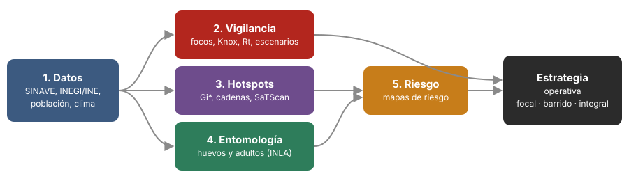

::: {.dv-hero}
# dengueverse

[Paquetes en R y Python para el análisis de la transmisión del dengue y la toma de decisiones operativas del programa de prevención y control del dengue en México.]{.lead}

[Empezar](instalacion.qmd){.btn .btn-primary} [Paquetes](#paquetes){.btn .btn-outline-secondary} [R-universe](https://fdzul.r-universe.dev){.btn .btn-outline-secondary} [English](../index.qmd){.btn .btn-outline-secondary}
:::

La palabra universo tiene diferentes significados. En R, un universo es una colección o ecosistema de paquetes que comparten una filosofía y un objetivo común, como el [tidyverse](https://www.tidyverse.org), [tidymodels](https://www.tidymodels.org), el [pharmaverse](https://pharmaverse.org) o el [epiverse](https://epiverse-trace.r-universe.dev). El **dengueverse** es la colección de paquetes que asiste en el análisis estadístico y la ciencia de datos del programa de prevención y control del dengue, y proporciona las bases para el diseño, implementación, escalamiento y evaluación de un modelo estratégico de focalización del dengue en las áreas urbanas y metropolitanas de México.

Originalmente, la materia prima del dengueverse eran las bases de datos de la vigilancia epidemiológica del Sistema Nacional de Vigilancia Epidemiológica (SINAVE) y de la vigilancia entomológica del Sistema Integral de Monitoreo de Vectores (SIMV). Actualmente el dengueverse está evolucionando tanto en insumos (acciones de control vectorial, clima, datos demográficos y antropogénicos) como en lenguajes de programación, con versiones de sus paquetes en Python.

## Flujo de trabajo

Los paquetes siguen el flujo de trabajo del programa: de los datos a la estrategia operativa.

{.dv-flow fig-alt="Flujo de trabajo del dengueverse: los datos alimentan la vigilancia, los hotspots y la entomología; estos alimentan los mapas de riesgo y la estrategia operativa."}

## Paquetes {#paquetes}

::: {.dv-stage}
[1]{.num} **Datos**: vigilancia, polígonos geográficos, población y clima.
:::

::: {#data}
:::

::: {.dv-stage}
[2]{.num} **Vigilancia**: análisis exploratorio, focos activos de transmisión y escenarios epidemiológicos.
:::

::: {#surveillance}
:::

::: {.dv-stage}
[3]{.num} **Hotspots y análisis espacio-temporal**: dónde persiste la transmisión.
:::

::: {#hotspots}
:::

::: {.dv-stage}
[4]{.num} **Entomología**: densidad del vector donde no se midió.
:::

::: {#entomology}
:::

::: {.dv-stage}
[5]{.num} **Riesgo**: mapas de riesgo de transmisión.
:::

::: {#risk}
:::

::: {.dv-note}
Las bases de datos del SINAVE son para uso exclusivo del personal de las Secretarías de Salud estatales y del nivel federal. Los ejemplos de los paquetes nunca publican la ubicación de los casos.
:::
