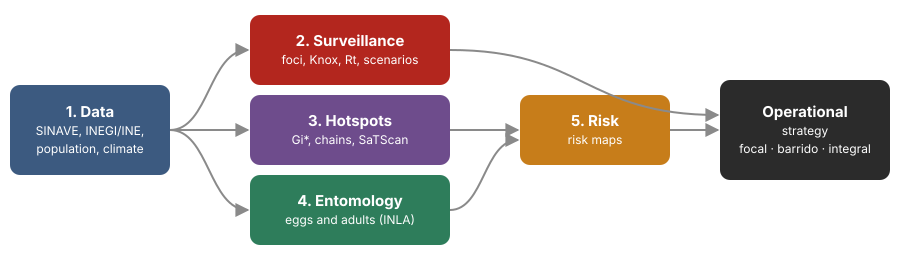

::: {.dv-hero}
# dengueverse

[R and Python packages for the analysis of dengue transmission and the operational decisions of the dengue prevention and control program in Mexico.]{.lead}

[Get started](install.qmd){.btn .btn-primary} [Packages](#packages){.btn .btn-outline-secondary} [R-universe](https://fdzul.r-universe.dev){.btn .btn-outline-secondary}
:::

In R, a *universe* is a collection of packages that share a philosophy and a common goal, such as the [tidyverse](https://www.tidyverse.org), [tidymodels](https://www.tidymodels.org), the [pharmaverse](https://pharmaverse.org) or the [epiverse](https://epiverse-trace.r-universe.dev). The **dengueverse** is the collection of packages that supports the statistical analysis and data science of the dengue prevention and control program, and provides the basis for designing, implementing, scaling up and evaluating a strategic model to target dengue control in the urban and metropolitan areas of Mexico.

The original raw material of the dengueverse is the epidemiological surveillance dataset of the National Epidemiological Surveillance System (SINAVE) and the entomological surveillance dataset of the Integrated Vector Monitoring System (SIMV). The dengueverse is growing both in inputs (vector control actions, climate, demographic and anthropogenic data) and in languages, with Python versions of its packages.

## Workflow

The packages follow the workflow of the program: from the data to the operational strategy.

{.dv-flow fig-alt="Workflow of the dengueverse: data feed surveillance, hotspots and entomology; these feed the risk maps and the operational strategy."}

## Packages {#packages}

::: {.dv-stage}
[1]{.num} **Data**: surveillance, geographic boundaries, population and climate.
:::

::: {#data}
:::

::: {.dv-stage}
[2]{.num} **Surveillance**: exploratory analysis, active transmission foci and epidemiological scenarios.
:::

::: {#surveillance}
:::

::: {.dv-stage}
[3]{.num} **Hotspots and space-time analysis**: where transmission persists.
:::

::: {#hotspots}
:::

::: {.dv-stage}
[4]{.num} **Entomology**: vector density where it was not measured.
:::

::: {#entomology}
:::

::: {.dv-stage}
[5]{.num} **Risk**: transmission risk maps.
:::

::: {#risk}
:::

::: {.dv-note}
The SINAVE datasets are for the exclusive use of the staff of the State Ministries of Health and of the federal level. The examples of the packages never publish case locations.
:::
